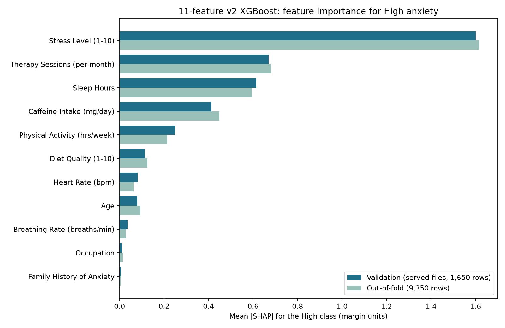

# SHAP (Phase 17) for the served 11-feature v2 XGBoost

Script: `src/explainability/shap_v2.py`. **The test set was not used.** Validation = the served files on the
1,650 validation rows; out-of-fold = 9,350 train + validation rows, 5-fold
stratified on the 3-class label (shuffled, seed 42), v2 params, preprocessing fitted inside each fold.
Exact TreeSHAP from XGBoost (`pred_contribs`); contributions to the raw class margin (softmax logit); exact TreeSHAP. Occupation (13 one-hot columns) and Family History
(2) are added back into one feature by summing each row's signed contributions. Synthetic-looking dataset:
SHAP describes this model on this data and is association, not cause.

## 1. Guard: the served files reproduce v2's validation numbers

Balanced accuracy 0.8055, 411 flagged at P(High) ≥ 0.025,
158/165 true High flagged — matches the documented 0.8055 / 411 / 158 of 165.

## 2. Additivity check

Contributions + bias = raw margin for every row and class: largest error 5.2e-06
(validation) and 4.8e-06 (out-of-fold folds).

## 3. Ranking for the High class (mean |SHAP|)

| Rank | Feature | Validation: mean \|SHAP\| (share) | Out-of-fold: rank (share) |
|---|---|---|---|
| 1 | Stress Level (1-10) | 1.5998 (41.3%) | 1 (41.6%) |
| 2 | Therapy Sessions (per month) | 0.6696 (17.3%) | 2 (17.5%) |
| 3 | Sleep Hours | 0.6143 (15.9%) | 3 (15.3%) |
| 4 | Caffeine Intake (mg/day) | 0.4136 (10.7%) | 4 (11.5%) |
| 5 | Physical Activity (hrs/week) | 0.2489 (6.4%) | 5 (5.5%) |
| 6 | Diet Quality (1-10) | 0.1140 (2.9%) | 6 (3.2%) |
| 7 | Heart Rate (bpm) | 0.0811 (2.1%) | 8 (1.6%) |
| 8 | Age | 0.0802 (2.1%) | 7 (2.4%) |
| 9 | Breathing Rate (breaths/min) | 0.0359 (0.9%) | 9 (0.7%) |
| 10 | Occupation | 0.0101 (0.3%) | 10 (0.4%) |
| 11 | Family History of Anxiety | 0.0057 (0.1%) | 11 (0.2%) |

### Compared with the earlier models (all-class view: mean |SHAP| averaged over Low/Medium/High, shares of total)

The earlier reports averaged over all three classes, so v2 is shown the same way here. Sources:
`shap_full_ranking_3class.md` is the **17-feature** Random Forest (500 validation rows); the three 12-feature
columns are from `model_comparison_12feature.md` (300 validation rows).

| Rank | v2 XGBoost, all classes (validation) | rf_17_feature | rf_current | rf_retuned | xgb_retuned |
|---|---|---|---|---|---|
| 1 | Stress Level (1-10) (46.0%) | Stress Level (1-10) (32.9%) | Stress Level (1-10) (37.6%) | Stress Level (1-10) (36.8%) | Stress Level (1-10) (44.3%) |
| 2 | Sleep Hours (15.7%) | Therapy Sessions (per month) (13.8%) | Therapy Sessions (per month) (13.2%) | Therapy Sessions (per month) (13.5%) | Sleep Hours (16.2%) |
| 3 | Therapy Sessions (per month) (14.4%) | Sleep Hours (12.7%) | Sleep Hours (12.5%) | Sleep Hours (13.4%) | Therapy Sessions (per month) (14.7%) |
| 4 | Caffeine Intake (mg/day) (10.2%) | Caffeine Intake (mg/day) (8.9%) | Caffeine Intake (mg/day) (11.0%) | Caffeine Intake (mg/day) (10.1%) | Caffeine Intake (mg/day) (10.2%) |
| 5 | Physical Activity (hrs/week) (4.8%) | Diet Quality (1-10) (6.1%) | Diet Quality (1-10) (5.9%) | Diet Quality (1-10) (6.1%) | Physical Activity (hrs/week) (4.9%) |
| 6 | Diet Quality (1-10) (2.2%) | Physical Activity (hrs/week) (4.3%) | Physical Activity (hrs/week) (3.9%) | Physical Activity (hrs/week) (4.1%) | Diet Quality (1-10) (2.2%) |
| 7 | Heart Rate (bpm) (1.8%) | Heart Rate (bpm) (3.9%) | Heart Rate (bpm) (3.8%) | Heart Rate (bpm) (3.6%) | Heart Rate (bpm) (1.8%) |
| 8 | Age (1.7%) | Family History of Anxiety (3.4%) | Family History of Anxiety (2.8%) | Occupation (2.9%) | Age (1.7%) |
| 9 | Family History of Anxiety (1.1%) | Breathing Rate (breaths/min) (2.6%) | Breathing Rate (breaths/min) (2.5%) | Family History of Anxiety (2.7%) | Occupation (1.4%) |
| 10 | Breathing Rate (breaths/min) (1.1%) | Sweating Level (1-5) (2.6%) | Occupation (2.5%) | Breathing Rate (breaths/min) (2.3%) | Family History of Anxiety (1.1%) |
| 11 | Occupation (0.8%) | Occupation (2.5%) | Age (2.3%) | Age (2.3%) | Breathing Rate (breaths/min) (1.0%) |
| 12 |  | Age (2.4%) | Sweating Level (1-5) (2.0%) | Sweating Level (1-5) (2.2%) | Sweating Level (1-5) (0.4%) |
| 13 |  | Alcohol Consumption (drinks/week) (1.3%) |  |  |  |
| 14 |  | Dizziness (0.9%) |  |  |  |
| 15 |  | Smoking (0.7%) |  |  |  |
| 16 |  | Recent Major Life Event (0.6%) |  |  |  |
| 17 |  | Medication (0.4%) |  |  |  |

## 4. Stress Level dominance (share of total mean |SHAP|)

| View | Stress Level share | Rank | Times the 2nd feature |
|---|---|---|---|
| validation high | 41.3% | 1 | 2.39x |
| oof high | 41.6% | 1 | 2.37x |
| validation all classes | 46.0% | 1 | 2.92x |
| oof all classes | 46.2% | 1 | 3.05x |

## 5. Caffeine shortcut (does v2 need high caffeine to predict High?)

**Observed:** true-High patients whose caffeine is ≤ 200 mg/day.

| View | True High with caffeine ≤ 200 | Of those, predicted High | Of those, flagged at 0.025 | All true High predicted High (for comparison) |
|---|---|---|---|---|
| Validation | 4 | 0 | 2 | 148 of 165 |
| Out-of-fold | 23 | 0 | 12 | 849 of 968 |

**Counterfactual:** every true-High validation patient with caffeine set to a fixed value (the form behind the
documented "Random Forest 0 of 165, 12-feature XGBoost 127–129"; that original script is not in the repo, so this
is a re-implementation, not a re-run).

| Caffeine set to | Still predicted High | Still flagged at 0.025 |
|---|---|---|
| 0 mg/day | 128 of 165 | 154 of 165 |
| 100 mg/day | 129 of 165 | 155 of 165 |
| 200 mg/day | 129 of 165 | 155 of 165 |

**Reading the two forms together.** v2 does not *require* high caffeine: with caffeine set to 0 mg/day, 128 of 165 true-High patients are still predicted High, so there is no hard shortcut like the Random Forest's. But the few true-High patients who actually report ≤ 200 mg/day (unusual in this data) are never labelled High (0 of 23 out-of-fold), and the review flag catches only 12 of 23 of them, far below its 96.2% catch rate for all true-High patients (`reports/calibration_review_flag_11feature_v2.md`). The sample is small (23 patients), but this is a **safety gap for low-caffeine High patients** to tell the psychologist reviewer about, and caffeine is only estimated from drink counts in the API.

**Coverage in the training data (train + validation, 9,350 rows).**

| Class | Rows (train + validation) | Caffeine ≤ 200 mg/day | Share of the class |
|---|---|---|---|
| Low | 4,421 | 1,731 | 39.2% |
| Medium | 3,961 | 1,191 | 30.1% |
| High | 968 | 23 | 2.4% |

**The 23 low-caffeine true-High rows vs the other true-High rows (out-of-fold).**

| Feature | Low-caffeine true High: median (mean) | Other true High: median (mean) | Mann-Whitney p |
|---|---|---|---|
| Stress Level (1-10) | 9 (9.3), n = 23 | 9 (9.06), n = 945 | 0.18 |
| Therapy Sessions (per month) | 3 (3.17), n = 23 | 6 (6.24), n = 945 | 1.4e-09 |
| Sleep Hours | 6.9 (6.65), n = 23 | 4.6 (4.75), n = 945 | 4.2e-10 |
| Caffeine Intake (mg/day) | 143 (128), n = 23 | 446 (443), n = 945 | 2.3e-16 |
| Physical Activity (hrs/week) | 2.2 (2.61), n = 23 | 1.1 (1.33), n = 945 | 0.00031 |
| P(High), out-of-fold | 0.0266 (0.0305), n = 23 | 0.982 (0.871), n = 945 | 1.3e-14 |

**Conclusion: a data-coverage gap, not a caffeine effect alone.** Low reported caffeine is rare among High patients in this data: 23 of 968 true-High rows (2.4%), against 39.2% of Low and 30.1% of Medium. These 23 patients have the same stress level as other High patients (median 9 vs 9, p = 0.18), but differ on the other top features: therapy sessions 3 vs 6 per month, sleep 6.9 vs 4.6 h, physical activity 2.2 vs 1.1 h/week (all p < 0.001). The model gives them a median P(High) of 0.027 against 0.982 for other High patients. So the training data contain very few High patients with high stress but lower values on the model's other risk signals (23 in 9,350 rows), and high stress alone does not move the model to High. This is likely an artifact of the (very likely synthetic) data; real patients with that profile could be under-detected in the same way. Small sample: a pattern to review, not an established effect.

## 6. The 17 true-High validation patients predicted Medium

Contributions to (High margin − Medium margin), which is what decides between High and Medium; negative values
pulled the patient toward Medium. Up to three strongest pulls per patient. 4 of the 17 are aged 50+,
which the live API refuses (supported range 18–49), so 13 are in the range the API serves.

| Val row | Age | P(High) | P(Medium) | Flagged at 0.025 | Pulled toward Medium (contribution to High − Medium margin; raw value) |
|---|---|---|---|---|---|
| 49 | 39 | 0.015 | 0.882 | no | Physical Activity (hrs/week) -0.93 (= 6.5); Sleep Hours -0.86 (= 7.9); Therapy Sessions (per month) -0.69 (= 2) |
| 84 | 30 | 0.030 | 0.883 | yes | Therapy Sessions (per month) -0.86 (= 0); Physical Activity (hrs/week) -0.79 (= 5.4); Sleep Hours -0.45 (= 6.3) |
| 186 | 32 | 0.019 | 0.846 | no | Physical Activity (hrs/week) -0.86 (= 6.0); Therapy Sessions (per month) -0.78 (= 0); Sleep Hours -0.47 (= 6.7) |
| 255 | 42 | 0.145 | 0.804 | yes | Physical Activity (hrs/week) -0.63 (= 4.6); Sleep Hours -0.47 (= 5.8); Diet Quality (1-10) -0.43 (= 6) |
| 519 | 20 | 0.175 | 0.614 | yes | Sleep Hours -1.32 (= 9.9); Physical Activity (hrs/week) -0.64 (= 4.6); Family History of Anxiety -0.09 (= Yes) |
| 575 | 22 | 0.014 | 0.760 | no | Sleep Hours -0.81 (= 8.2); Therapy Sessions (per month) -0.68 (= 2); Caffeine Intake (mg/day) -0.63 (= 103) |
| 668 | 62 (50+, refused by the API) | 0.030 | 0.810 | yes | Caffeine Intake (mg/day) -0.66 (= 101); Sleep Hours -0.63 (= 7.6); Therapy Sessions (per month) -0.41 (= 3) |
| 800 | 20 | 0.021 | 0.907 | no | Physical Activity (hrs/week) -0.62 (= 4.8); Therapy Sessions (per month) -0.46 (= 3); Sleep Hours -0.44 (= 6.6) |
| 804 | 64 (50+, refused by the API) | 0.174 | 0.749 | yes | Sleep Hours -1.11 (= 7.5); Age -0.22 (= 64); Heart Rate (bpm) -0.17 (= 75) |
| 938 | 52 (50+, refused by the API) | 0.034 | 0.883 | yes | Therapy Sessions (per month) -0.95 (= 0); Sleep Hours -0.43 (= 6.7); Physical Activity (hrs/week) -0.32 (= 3.2) |
| 1083 | 39 | 0.020 | 0.918 | no | Sleep Hours -1.20 (= 7.6); Physical Activity (hrs/week) -0.97 (= 5.5); Therapy Sessions (per month) -0.65 (= 3) |
| 1125 | 61 (50+, refused by the API) | 0.016 | 0.813 | no | Therapy Sessions (per month) -0.86 (= 1); Caffeine Intake (mg/day) -0.77 (= 60); Sleep Hours -0.35 (= 6.4) |
| 1395 | 24 | 0.095 | 0.871 | yes | Therapy Sessions (per month) -0.90 (= 3); Caffeine Intake (mg/day) -0.46 (= 294); Physical Activity (hrs/week) -0.28 (= 2.9) |
| 1540 | 45 | 0.036 | 0.908 | yes | Therapy Sessions (per month) -0.68 (= 2); Physical Activity (hrs/week) -0.53 (= 4.9); Sleep Hours -0.45 (= 6.4) |
| 1546 | 34 | 0.125 | 0.778 | yes | Therapy Sessions (per month) -1.77 (= 1); Diet Quality (1-10) -0.40 (= 10); Physical Activity (hrs/week) -0.33 (= 3.0) |
| 1554 | 35 | 0.071 | 0.864 | yes | Caffeine Intake (mg/day) -0.71 (= 165); Therapy Sessions (per month) -0.47 (= 3); Sleep Hours -0.34 (= 6.3) |
| 1644 | 20 | 0.011 | 0.716 | no | Stress Level (1-10) -1.38 (= 7); Sleep Hours -1.01 (= 7.5); Physical Activity (hrs/week) -0.50 (= 4.9) |

Across the 17:

| Feature | Mean contribution to (High − Medium) | Among the top 2 pulls toward Medium |
|---|---|---|
| Sleep Hours | -0.493 | 9 of 17 |
| Physical Activity (hrs/week) | -0.414 | 8 of 17 |
| Therapy Sessions (per month) | -0.408 | 10 of 17 |
| Caffeine Intake (mg/day) | -0.107 | 4 of 17 |
| Diet Quality (1-10) | -0.085 | 1 of 17 |
| Heart Rate (bpm) | -0.083 | 0 of 17 |
| Occupation | -0.018 | 0 of 17 |
| Breathing Rate (breaths/min) | -0.015 | 0 of 17 |
| Family History of Anxiety | -0.010 | 0 of 17 |
| Age | +0.017 | 1 of 17 |
| Stress Level (1-10) | +0.238 | 1 of 17 |

## 7. Direction check for modifiable features (the recommendation engine depends on this)

Spearman correlation between each raw value and its High-class SHAP (positive = more of it pushes toward High),
and the mean High-class SHAP across value quintiles.

| Feature | Clinical expectation | Spearman (validation / out-of-fold) | Mean High SHAP by quintile, low → high (validation) | Monotonic (val / oof) | Matches |
|---|---|---|---|---|---|
| Sleep Hours | higher -> less risk | -0.945 / -0.927 | +1.072, -0.225, -0.354, -0.616, -0.800 | yes / yes | **yes** |
| Caffeine Intake (mg/day) | higher -> more risk | +0.906 / +0.866 | -0.625, -0.568, -0.317, +0.085, +0.447 | yes / no | **yes** |
| Physical Activity (hrs/week) | higher -> less risk | -0.942 / -0.902 | +0.248, +0.125, -0.110, -0.212, -0.509 | yes / yes | **yes** |
| Diet Quality (1-10) | higher -> less risk | -0.735 / -0.772 | +0.071, +0.028, -0.160, -0.192, -0.143 | no / no | **yes** |

**Conflicts with the clinical direction:** none.
**Right overall direction but not monotonic across quintiles:** Caffeine Intake (mg/day), Diet Quality (1-10).
A matching direction only shows the model's association on this dataset; it is not evidence that changing the
input would change a patient's risk.

Libraries: python 3.13.13, xgboost 3.4.1, scikit-learn 1.9.1, numpy 2.5.3, pandas 3.0.5.
